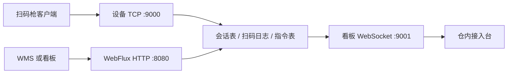

# 总体架构

进程里有三套 Netty，互不共用 `EventLoopGroup`。

| Netty | 谁创建的 | 线程名前缀 | 做什么 |
| --- | --- | --- | --- |
| Reactor Netty | Spring Boot 的 `NettyWebServer` | `reactor-http-nio` | HTTP、SSE、静态页面 |
| 设备接入 | `NettyTcpServerLifecycle` | `warehouse-boss`、`warehouse-worker`、`warehouse-biz` | 私有帧协议 |
| 看板 | `NettyWebSocketServerLifecycle` | `dashboard-boss`、`dashboard-worker` | WebSocket 文本帧 |
| 模拟枪 | `DeviceSimulator` | `device-client` | 作为 TCP 客户端拨号 |

HTTP 用的是 `spring-boot-starter-webflux`，不是 `spring-boot-starter-web`。两个 starter 同时存在时，Spring Boot 会选 Servlet 容器，WebFlux 就不再是服务端。这一点在 [WebFlux 接口](06-WebFlux接口.md) 里展开。

## 包

`com.allst.springboot` 在启动类的组件扫描里，只有看板页面要用的 HTTP 层：

- `warehouse.api`：接口和错误体
- `warehouse.GatewayStartupLogger`：启动后打印三个地址

`com.allst.netty` 不在扫描范围内，由自动配置装入。见 [自动配置](10-自动配置.md)。

- `protocol`：帧和 JSON 消息，不依赖 Spring
- `session`：会话、扫码、指令，不依赖 Spring
- `push`：把事件送给 WebSocket 和 SSE
- `tcp` / `client` / `websocket`：三组 Netty 的生命周期
- `autoconfigure`：条件装配

## 一次扫码

1. 模拟枪把 `SCAN` 写成一帧，发到 9000。
2. `warehouse-worker` 按长度字段切帧，再解析 JSON。
3. `warehouse-biz` 上的 `WarehouseServerHandler` 确认这台设备已经登录，写入 `RecentEventLog`，调用 `RealtimePushService.scan`。
4. 推送服务把同一条消息写给所有看板 Channel，并推进 SSE 的 `Sinks.Many`。
5. 服务端回 `ACK`。枪不需要为扫码再做业务处理。

## 一次下发

1. 看板或 WMS 调用 `POST /api/devices/{deviceId}/commands`。
2. 接口在 Reactor Netty 的线程里找到 `Channel`。不在线返回 404，写缓冲满返回 429。
3. 接口立刻返回 202 和状态 `SENT`，不等待设备。
4. `channel.writeAndFlush` 把 `COMMAND` 排到这条连接所属的 I/O 线程。
5. 枪在自己的 EventLoop 里回 `ACK`，`requestId` 与下发时相同。
6. 服务端把指令改成 `ACKED`，看板收到 `COMMAND_ACK`。

查询回执：`GET /api/commands/{requestId}`。
