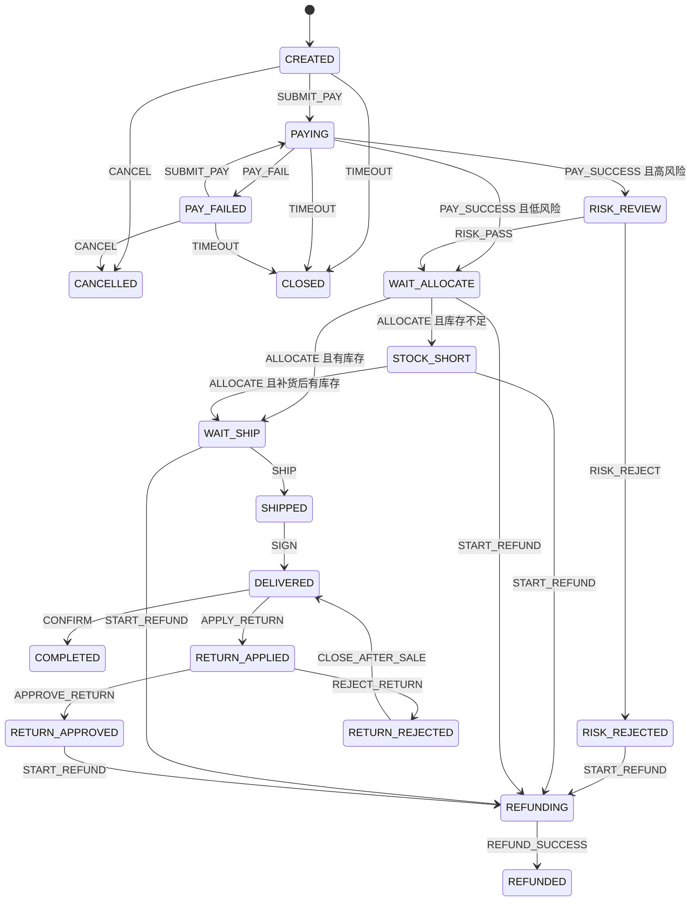

# 订单状态、事件和代码位置

主配置是 `TradeOrderStateMachineConfig`，工厂名 `tradeOrderMachineFactory`。高风险阈值默认 80，支付超时默认 30 分钟，都在 `statemachine.trade` 下。

## 状态

图里的支付分流和库存分流是选择伪状态，没有画成可停留节点。`RETURN_*` 画在主线上，实际配置挂在父状态 `AFTER_SALE` 下面。

终态是 `COMPLETED`、`REFUNDED`、`CANCELLED`、`CLOSED`。终态没有出边，目录返回空列表。

## 事件从哪里来

| 事件 | 谁发送 | 机器做什么 |
| --- | --- | --- |
| `SUBMIT_PAY` | 收银台 | 待支付或支付失败 → 支付中。金额和支付时限都要过 |
| `PAY_SUCCESS` / `PAY_FAIL` | 支付回调 | 成功后按风险分分流，并写支付时间 |
| `CANCEL` | 买家 | 未支付成功时取消 |
| `TIMEOUT` | `PayTimeoutScanner` | 关闭长时间没付完的订单 |
| `RISK_PASS` / `RISK_REJECT` | 风控人员 | 人工审核的两个出口 |
| `ALLOCATE` | 履约 | 条件占库存，或进入缺货 |
| `SHIP` | 仓库 | 必须带物流单号 |
| `SIGN` | 物流 | 进入已签收 |
| `CONFIRM` | 买家或系统 | 完成，并在提交后通知会员 |
| `APPLY_RETURN` / `APPROVE_RETURN` / `REJECT_RETURN` / `CLOSE_AFTER_SALE` | 售后 | 在层级状态里往返 |
| `START_REFUND` / `REFUND_SUCCESS` | 售后或支付 | 进入退款中，渠道成功后再到已退款 |

风险分在创建订单时写入，支付回调不必再传一遍。模板恢复时把它放进扩展状态，`HighRiskGuard` 从那里读。

## 类怎么分工

| 类 | 职责 |
| --- | --- |
| `TradeOrderController` | 校验入参，转成命令 |
| `TradeOrderAppService` | 门面。写操作加锁，查询不加锁 |
| `TradeOrderFlowService` | 事务、幂等、调用模板、回写状态、记流水 |
| `OrderMachineTemplate` | 机器实例的取出、恢复、发送、停止 |
| `TradeOrderStateMachineConfig` | 全部转移 |
| `OrderEventCatalog` | 当前状态允许的事件 |
| `TradeOrder` / `SkuStock` / `TransitionLog` | 订单、库存、流水 |
| `PayTimeoutScanner` | 补发超时事件 |
| `ParallelPrecheckService` | 下单前的并行查询，不改状态 |

表：

| 表 | 用途 |
| --- | --- |
| `sm_trade_order` | 订单当前状态和附属字段 |
| `sm_sku_stock` | 可售库存 |
| `sm_transition_log` | 三种机器共用的流水。`machine_type + machine_id + event_id` 唯一 |

订单号前缀 `T`。演示 SKU 由 `DemoStockInitializer` 在非 test 环境写入。
