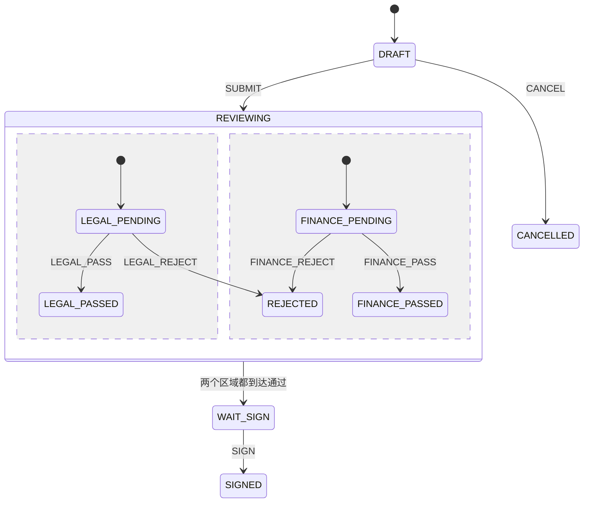

# 补充场景：合同的两条审核同时进行

订单履约大多是一条线往前走。合同不是。提交之后，法务和财务可以按任意顺序审，两边都通过才能签署；任意一边驳回，整份合同结束，另一边不能再审。

用一个状态字段硬写的话，会出现 `LEGAL_OK_FINANCE_PENDING`、`LEGAL_PENDING_FINANCE_OK` 这种组合爆炸。每加一个部门，状态数量翻倍。

## 机器形状

`ContractStateMachineConfig` 使用 fork / join，父状态是 `REVIEWING`，两个区域的 id 是 `LEGAL` 和 `FINANCE`。

`SUBMIT` 进入分叉，同时激活两个区域。`NotifyReviewersAction` 在这次转移里登记两条提交后任务：`legal-review:{contractNo}` 和 `finance-review:{contractNo}`。两条通知彼此独立，都进同一个线程池。

任一侧的通过只结束自己的区域。另一侧还停在待审时，合同阶段仍是 `REVIEWING`。两侧的结束状态都到达后，join 把机器带到 `WAIT_SIGN`。这次 join 没有单独的业务事件，它是上一笔通过事件的后续。

驳回的目标是根上的 `REJECTED`，区域被一起退出。所以驳回之后再发送另一侧的通过，机器不会接受。

## 表里为什么是三个字段

只存一个 `phase` 无法表达“法务已经过了、财务还没有”。`sm_sales_contract` 因此有：

| 字段 | 含义 |
| --- | --- |
| `phase` | 草稿、并行审核、待签署、已签署、已驳回、已取消 |
| `legal_status` | 法务区域的当前位置 |
| `finance_status` | 财务区域的当前位置 |

`ContractEventCatalog` 用这三个值决定按钮。并行审核中，法务已经通过时，列表里不再出现法务事件，财务事件还在。

join 完成时，活动状态集合里可能只剩 `WAIT_SIGN`，区域结束状态已经不在集合中。`ContractFlowService.apply` 遇到 `LEGAL_PASS` 或 `FINANCE_PASS` 时直接把对应轨道写成通过，避免汇合把刚通过的结果抹掉。

## 和订单机器的相同点

`ContractAppService` 同样先按合同号加锁，再进入事务。`ContractMachineTemplate` 同样是恢复、发送、停止。流水写在 `sm_transition_log`，`machine_type` 为 `CONTRACT`。

并行的是两条审核区域，不是两个线程去改同一台机器。通知才使用线程池，而且在提交之后。
